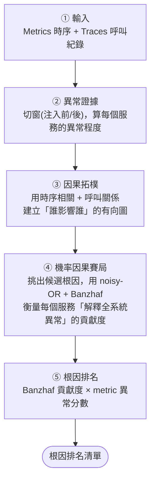

# GaBanzhaf 流程圖

論文用的整體流程概覽（精簡版）。可在 mermaid.live 或支援 Mermaid 的 markdown 檢視器渲染，匯出 SVG/PNG。

## 對應程式碼

| 步驟 | 主要函式 (`RCAEval/e2e/gabanzhaf.py`) |
|---|---|
| ① 輸入 + Trace 特徵 | `_extract_trace_features` / `_extract_call_graph` |
| ② 異常證據 | `_split_raw_windows` → `_metric_evidence` → `_service_evidence` |
| ③ 因果拓樸 | `_build_topology` + `_call_graph_topology_edges` → `_upstream_maps` |
| ④ 機率因果賽局 | `_residual_scores` → `_select_exact_candidates` → `_causal_explanation_matrix` → `_probabilistic_banzhaf` |
| ⑤ 根因排名 | `_rank_metrics` |
