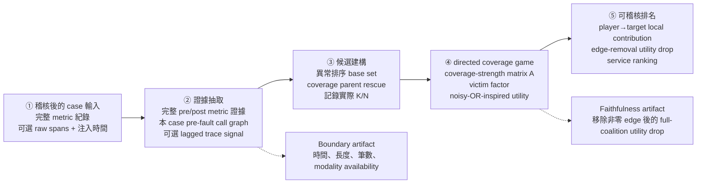

# MERIT 流程圖

論文用的整體流程概覽。正式英文稿採用 repository-native TikZ 版本
`paper/merit_pipeline.tex`；下列 Mermaid 保持相同語義，供文件快速檢視。

## 對應程式碼

2026-10-07 模組化後，`merit.py` 只協調流程與保留相容名稱；實作位置如下。`_banzhaf_power` 在入口保留相容轉接，替代歸因位於 `merit_ablation.py`。

| 步驟 | 權威模組與主要函式 |
|---|---|
| ① 輸入 + Trace 特徵 | `merit_trace.py`：`prepare_case_inputs`、`_resolve_graph_artifact`、`_build_call_graph_from_traces`、`_trace_topology_from_case_dir` |
| ② 異常證據 | `merit_evidence.py`：`_split_raw_windows` → `_preprocess_windows` → `_metric_evidence` → `_service_evidence` |
| ③ 候選與 directed edges | `merit_game.py`：`_coverage_parents`、`_augment_coverage_candidates`、`_causal_edges`、`_select_exact_candidates` |
| ④ coverage game | `merit_game.py`：`_causal_explanation_matrix`、coverage／trace edge、victim、閉式 Banzhaf |
| ⑤ 根因排名與輸出 | `merit_evidence.py` 排名；`merit_diagnostics.py` 組裝 diagnostics 與 canonical timing |

## Controlled variants

- `no_trace` 在第二步 evidence extraction 只保留 metric evidence：入口即跳過
  call graph、trace time-series 與所有 trace-derived evidence，也會清除呼叫端誤傳的
  trace inputs。後續仍執行相同的候選建構、coverage-strength matrix、
  victim demotion、coverage game、Banzhaf 與排序步驟，但這些步驟不會收到
  call graph、trace edge、trace score 或其他 trace-derived 資訊。
- `no_trace_topology` 保留由 `traces.csv` 建立的 call-graph coverage，但不讀取
  `tracets_lat.csv`／`tracets_err.csv`，因此沒有動態 trace edge。
- `trace_only` 先以注入前後 residual 計算各服務的 trace 幅度，再跨服務正規化；
  不再對每條序列各自 min-max 後取最大值。
- `individual attribution` 保留相同 players、targets、anomaly weights、coverage-
  strength matrix、coverage 與 victim factors，只把 coalition Banzhaf 邊際貢獻
  換成 singleton weighted coverage。
- primary graph 只使用每個 case 自己的 pre-fault spans；first-case、union、
  per-case-full 與 case-order 皆為 sensitivity condition。
- `first_case_pre_fault` 由 runner 在 shuffle／limit 後固定 `graph_reference_case_id`；
  cache 保存圖與來源。空圖亦固定，worker 重啟仍由同一 reference 重建。缺 reference
  直接報錯。union provenance 不冒充單一來源，而記完整排序後來源集合與 manifest digest。
- 啟用 `return_diagnostics` 時，才計算及輸出 nonzero player→target edge 的
  local contribution 與 edge-removal utility drop；預設排名路徑不輸出這些矩陣。
  這些診斷不代表 calibrated probability 或 structural causal explanation。
